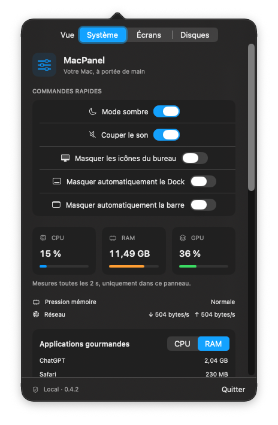
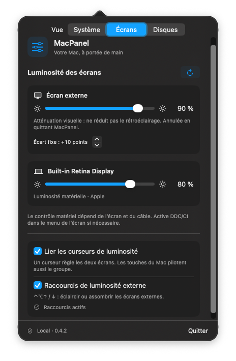
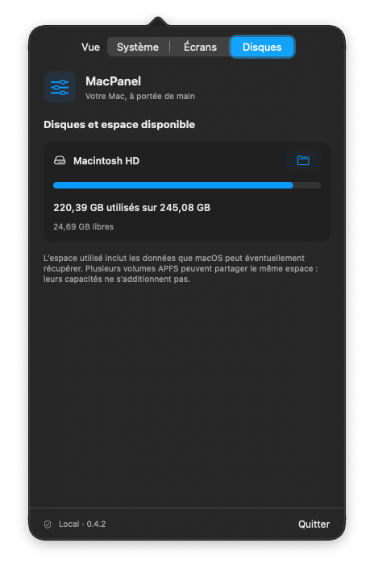
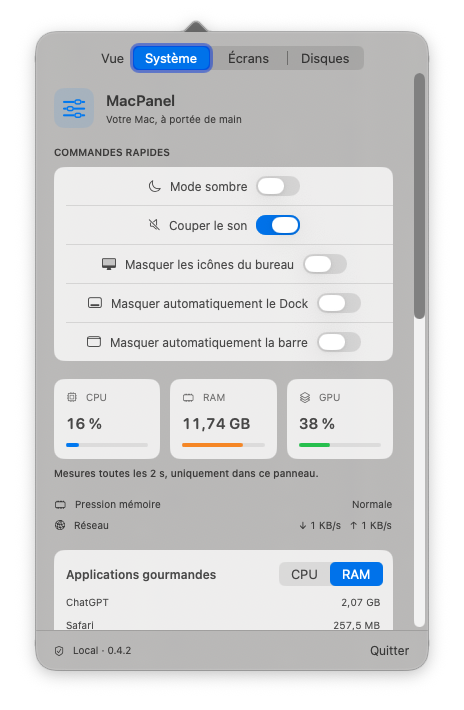
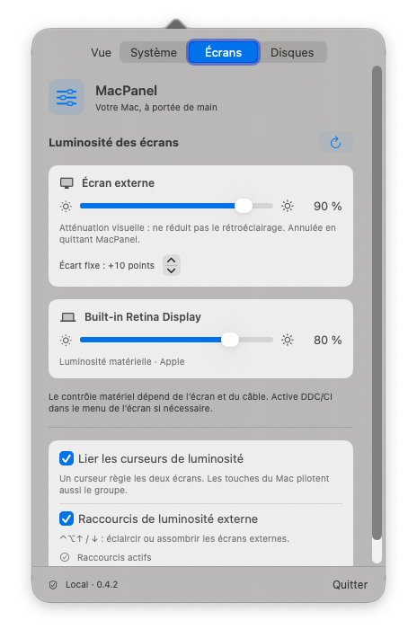
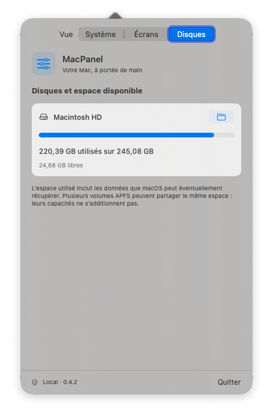
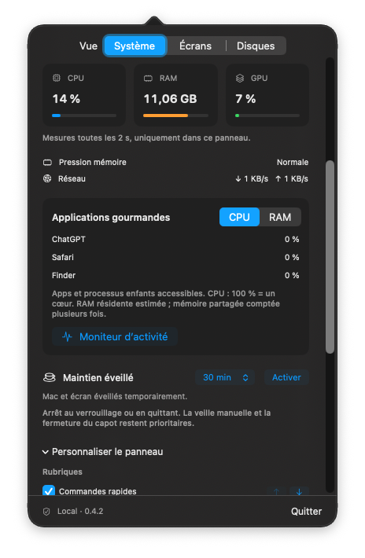
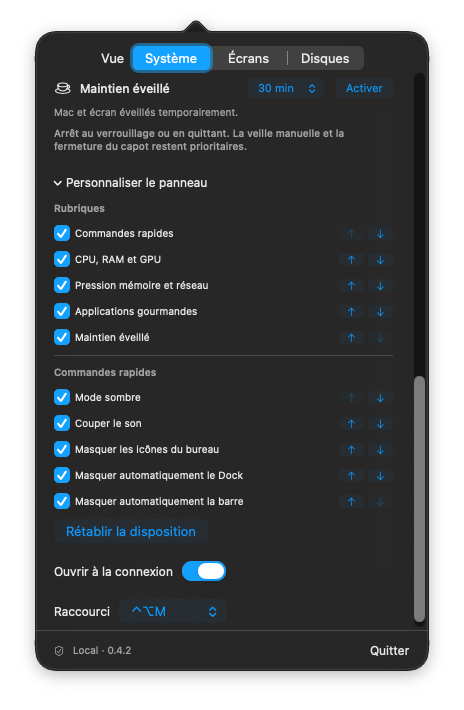
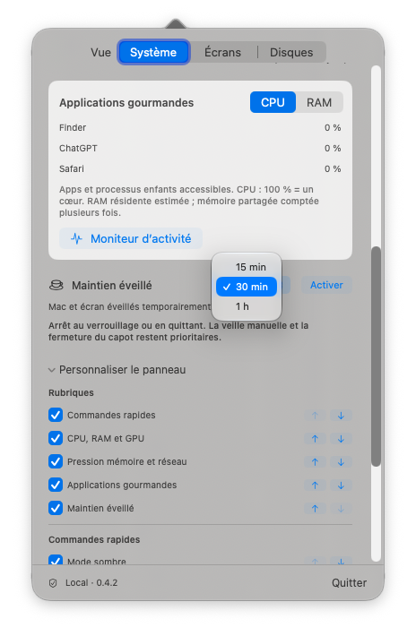

<p align="center"></p>
<h1 align="center">MacPanel</h1>
<p align="center"><strong>L’essentiel de votre Mac, à portée de menu.</strong><br>Commandes rapides, activité système, luminosité et stockage dans un petit panneau natif.</p>
<p align="center">
  <a href="https://github.com/JulienEsbt/MacPanel/actions/workflows/macos.yml"></a>
  
  
  <a href="LICENSE"></a>
</p>
<p align="center"><a href="README.md">English</a> · <strong>Français</strong></p>

MacPanel rassemble les commandes et les mesures utiles du Mac dans une seule application de barre des menus.
Développée avec **SwiftUI et AppKit**, elle fonctionne localement, sans compte, publicité, analyse d’usage,
fonction d’IA ou service administrateur. Les mesures système s’arrêtent à la fermeture du panneau ; la synchronisation optionnelle des écrans est détaillée plus bas.

**Version locale · 0.4.2.** L’interface est actuellement en français ; la documentation existe en français et en anglais.

## Aperçu

<table>
  <tr><th>Système</th><th>Écrans</th><th>Stockage</th></tr>
  <tr>
    <td><a href="docs/images/system-dark.png"></a></td>
    <td><a href="docs/images/displays-dark.png"></a></td>
    <td><a href="docs/images/disks-dark.png"></a></td>
  </tr>
</table>

MacPanel **0.4.2** · Interface française · Mode sombre. Cliquer sur une capture pour l’ouvrir à sa résolution d’origine.

<details>
<summary><strong>Voir le mode clair et les autres commandes</strong></summary>

<table>
  <tr><th>Système</th><th>Écrans</th><th>Stockage</th></tr>
  <tr>
    <td><a href="docs/images/system-light.png"></a></td>
    <td><a href="docs/images/displays-light.png"></a></td>
    <td><a href="docs/images/disks-light.png"></a></td>
  </tr>
</table>

<table>
  <tr><th>Activité des apps</th><th>Personnalisation</th><th>Maintien éveillé</th></tr>
  <tr>
    <td><a href="docs/images/activity-dark.png"></a></td>
    <td><a href="docs/images/customization-dark.png"></a></td>
    <td><a href="docs/images/awake-light.png"></a></td>
  </tr>
</table>

</details>

Neuf captures réelles fournies par JulienEsbt le 24 novembre 2026, reprises sans retouche. Les capacités des écrans et les mesures dépendent du matériel. [Provenance et images réutilisables](docs/images/README.md).

## Fonctionnalités

| Domaine | Ce que propose MacPanel |
|---|---|
| **Activité système** | Utilisation globale CPU/GPU, estimation de la mémoire unifiée utilisée et pression mémoire de macOS. |
| **Réseau** | Débits entrants et sortants Wi-Fi/Ethernet issus des compteurs locaux. Aucun serveur de test ni inspection des paquets. |
| **Commandes rapides** | Mode sombre, icônes du bureau, masquage automatique du Dock/de la barre des menus, et Muet sur les sorties compatibles. |
| **Maintien éveillé** | Sessions de 15, 30 ou 60 minutes ; arrêt manuel, à échéance, au verrouillage, à la veille ou en quittant. |
| **Écrans** | Luminosité par écran, modifiée pendant le déplacement du curseur. Option **Contrôle + Option + ↑/↓** pour tous les écrans externes réglables, même panneau fermé. Commandes matérielles Apple/DDC compatibles et atténuation logicielle explicitement indiquée en repli. |
| **Stockage** | Volumes montés, espace utilisé sur le total et espace libre, ouverture dans Finder et éjection des volumes externes compatibles. |
| **Accès quotidien** | Raccourci configurable, **Contrôle + Option + M** par défaut, et ouverture à la connexion sans afficher le panneau. |

## Nouveautés 0.4

- **Système :** cinq apps principales classées par CPU ou mémoire résidente, avec leurs enfants accessibles. CPU à 100 % = un cœur ; RAM partagée potentiellement comptée plusieurs fois. Aucun chemin, argument, contenu de fenêtre ou historique d’app conservé.
- **Personnaliser le panneau :** masquer et réordonner les rubriques et commandes ; choix conservés entre relances. L’accès aux réglages reste disponible.
- **Écrans :** option « Lier les curseurs de luminosité » : chaque curseur règle le groupe, avec un écart fixe individuel ±50 points conservé par UUID. L’écart se règle avec les boutons −/+ ; déplacer la luminosité ne le réécrit pas. Des pourcentages identiques ne garantissent pas la même luminance perçue et les limites peuvent réduire l’écart visible.
- **Audio écran :** curseur DDC/CI du volume lorsque l’écran le confirme (VCP 0x62). Affiché uniquement si l’écran confirme sa compatibilité ; sinon, aucune ligne audio inutile. Aucun changement de sortie audio ni repli logiciel sur le son du Mac.
- **Disques :** éjection groupée après confirmation, sans forcer les volumes occupés ; compte rendu d’échec partiel.

La synchronisation activée lit l’écran intégré environ une fois par seconde même panneau fermé ; elle s’arrête en veille/verrouillage. Les autres mesures restent limitées au panneau visible. La liste des apps s’arrête aussi hors de l’onglet Système ou lorsque sa rubrique est masquée.

## Utilisation

Lancez MacPanel depuis Applications, puis cliquez sur l’icône des **trois curseurs** dans la barre des menus ou utilisez **⌃⌥M**.
Les vues **Système**, **Écrans** et **Disques** regroupent les fonctions. Le raccourci peut être changé ou désactivé dans Système. Dans Écrans, les curseurs apparaissent en premier ; la liaison et les options de clavier sont regroupées dessous.

Le premier changement d’apparence peut demander l’autorisation de piloter **Événements système**.
Activez **Raccourcis de luminosité externe** dans Écrans pour utiliser **⌃⌥↑**
pour éclaircir et **⌃⌥↓** pour assombrir tous les écrans externes réglables. Chaque appui
change le niveau de 1/16 ; l’atténuation logicielle s’arrête à 20 % minimum. Les touches
habituelles de luminosité restent entièrement gérées par macOS. Sans écran externe
réglable connecté, ces raccourcis ne changent aucun écran. Lorsque la liaison est activée avec un écran intégré disponible, les commandes de luminosité pilotent le groupe lié ; sinon, les raccourcis dédiés ne visent que les externes.
Cette fonction ne demande ni Accessibilité, ni System & App Protection Override,
ni Surveillance de l’entrée, ni Enregistrement de l’écran, ni Accès complet au disque.
Seuls les deux raccourcis sont enregistrés ; aucune saisie ordinaire n’est observée ou
conservée. Un conflit avec un raccourci existant produit une erreur visible.
Les commandes bureau/Dock/barre peuvent relancer leur composant macOS ; les fichiers restent en place.

## Compiler le projet

Prérequis : **macOS 14+**, **Xcode 16+** avec Swift 6 et [XcodeGen](https://github.com/yonaskolb/XcodeGen).
Aucune dépendance Swift Package à télécharger.

```sh
git clone https://github.com/JulienEsbt/MacPanel.git
cd MacPanel
brew install xcodegen
bash scripts/test.sh
bash scripts/build.sh
```

L’application est produite dans `.build/Build/Products/Release/MacPanel.app`.
Quittez une ancienne copie avant de la remplacer dans Applications.

La compilation utilise par défaut une signature locale ad hoc. Une identité Apple existante peut être choisie :

```sh
MACPANEL_SIGN_IDENTITY="Votre identité de signature existante" \
MACPANEL_TEAM="Votre identifiant d’équipe" bash scripts/build.sh
```

Le script ne crée aucun certificat et ne change pas le Xcode sélectionné globalement.
Il n’existe actuellement **aucun téléchargement précompilé notarié**. La signature de développement local n’est pas une notarisation.

## Choix et limites

- **Clavier :** seuls les raccourcis explicitement enregistrés sont reçus. Arrêt au verrouillage/à la veille et reprise après déverrouillage/réveil. Détection des écrans à l’ouverture, à l’activation des raccourcis et aux changements de configuration, sans détection périodique en arrière-plan. La liaison optionnelle lit le niveau intégré une fois par seconde lorsque le Mac est éveillé et déverrouillé.
- **Activité réduite en arrière-plan :** mesures CPU/GPU/mémoire/réseau toutes les deux secondes lorsque le panneau est ouvert ; lecture des disques toutes les cinq secondes lorsqu’elle est active. La luminosité suit aussi les changements natifs pendant l’ouverture du panneau. Aucun historique conservé.
- **Mesures explicites :** une valeur absente affiche `—`. La mémoire utilisée est estimée ; la pression mémoire correspond au niveau du système, pas à un seuil déduit du pourcentage occupé. Le compteur GPU dépend du pilote.
- **Compatibilité des écrans :** la luminosité Apple et le transport DDC Apple Silicon utilisent des interfaces Apple privées détectées dynamiquement. Elles peuvent changer selon macOS. Le contrôle matériel dépend de l’écran, de la connexion et de l’activation de DDC/CI. Le DDC externe est actuellement implémenté pour Apple Silicon.
- **Atténuation logicielle :** elle modifie les tables de rendu de l’image, sans réduire le rétroéclairage ou la consommation de l’écran. Elle est temporaire et restaurée en quittant si MacPanel possède encore le réglage appliqué. D’autres utilitaires d’écran peuvent interagir avec elle.
- **Stockage :** espace utilisé et espace libre proviennent des mêmes compteurs du système de fichiers. L’espace utilisé inclut les données que macOS peut récupérer. Des volumes APFS peuvent partager leur capacité ; elle ne s’additionne pas. macOS conserve le contrôle de l’éjection des volumes occupés. Aucun nettoyage de fichiers ni démontage forcé.
- **Veille :** l’app ne continue pas à exécuter du code quand le Mac dort ou est éteint. Le maintien éveillé ne remplace pas la veille manuelle ou la fermeture du capot.
- **Rôles séparés :** la gestion de charge reste dans [OpenDente](https://github.com/JulienEsbt/OpenDente). MacPanel ne duplique pas ses limites et commandes de batterie.

## Développement

- [Spécification](SPEC.md) — périmètre et comportement
- [Validation](VALIDATION.md) — matériel testé, vérifications et limites
- [Changelog](CHANGELOG.md) — évolutions
- [Contribution](CONTRIBUTING.md) — compilation, tests et règles de modification
- [Sécurité](SECURITY.md) — signaler un problème de sécurité

Les tests XCTest couvrent les calculs, les mesures absentes/invalides, les protections d’éjection,
les réponses DDC, le routage des raccourcis et les bornes de luminosité, la disposition du clavier, le placement multi-écrans et les assertions temporaires de veille.
La compatibilité matérielle doit toujours être vérifiée avec l’écran, le câble et le dock concernés. La version locale passe 42 tests natifs. Les curseurs liés ont été vérifiés sur le Mac de développement ; sa connexion externe permet l’atténuation logicielle, mais ne fournit pas de réponse DDC valide pour la luminosité ou le son.

## Crédits et licence

Projet créé par [Julien Esterbet](https://github.com/JulienEsbt), sous [licence MIT](LICENSE).

Le transport des écrans externes adapte des parties de [waydabber/m1ddc](https://github.com/waydabber/m1ddc),
également sous MIT. Ses mentions de copyright et sa licence sont conservées dans le dépôt et dans l’app.
Les [mentions tierces](THIRD_PARTY.md) détaillent la révision et le périmètre repris.
[MonitorControl](https://github.com/MonitorControl/MonitorControl) et [Stats](https://github.com/exelban/stats)
servent de références de produit ; MacPanel est un projet indépendant.
