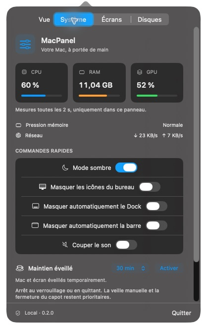
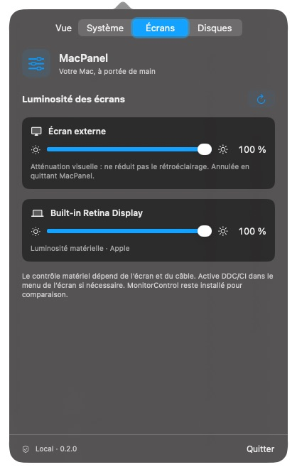
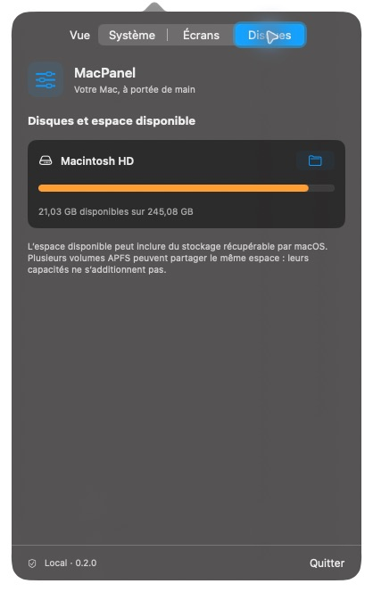

<p align="center">
  
</p>
<h1 align="center">MacPanel</h1>
<p align="center"><strong>Your Mac’s essentials, one menu away.</strong><br>Quick controls, system activity, display brightness and storage in a small native macOS panel.</p>
<p align="center">
  <a href="https://github.com/JulienEsbt/MacPanel/actions/workflows/macos.yml"></a>
  
  
  <a href="LICENSE"></a>
</p>
<p align="center"><strong>English</strong> · <a href="README.fr.md">Français</a></p>

MacPanel brings the controls and readings you reach for into one menu bar app.
Built with **SwiftUI and AppKit**, it runs locally, with no account, advertising,
analytics, AI features or administrator helper. Hardware sampling stops when the panel closes.

**Early release · 0.2.0.** The current interface is in French. Documentation is available in English and French.

## A look inside

<table>
  <tr><th>System</th><th>Displays</th><th>Disks</th></tr>
  <tr>
    <td></td>
    <td></td>
    <td></td>
  </tr>
</table>

Real screenshots of MacPanel on a MacBook Air M3. Display capabilities and storage readings depend on your setup.

## What it does

| Area | Features |
|---|---|
| **System activity** | Overall CPU and GPU usage, estimated unified memory usage, and macOS memory pressure. |
| **Network** | Current incoming and outgoing Wi-Fi/Ethernet traffic, measured from local interface counters. No speed-test server or packet inspection. |
| **Quick controls** | Dark appearance, desktop icons, Dock/menu bar auto-hide, and mute for a supported audio output. |
| **Stay awake** | Temporary 15-, 30- or 60-minute sessions. Stop manually, at expiry, on lock, on sleep or when quitting. |
| **Displays** | Per-display brightness, updated while moving the slider. Apple hardware control, external DDC/CI where supported, and clearly labelled software dimming otherwise. |
| **Storage** | Mounted volumes, total/available space, opening in Finder, and ejection of eligible external volumes. |
| **Everyday access** | Configurable global shortcut, default **Control + Option + M**, and optional launch at login without opening the panel. |

## Use it

Launch MacPanel from Applications and click the **three-sliders icon** in the menu bar, or press **⌃⌥M**.
Switch between **Système**, **Écrans** and **Disques**. Change or disable the shortcut in the System view.

The first dark-mode change may ask permission to automate **System Events**.
MacPanel does not require Accessibility, Screen Recording or Full Disk Access for these features.
Desktop/Dock/menu bar changes may restart their macOS interface component; files are not moved or deleted.

## Build from source

Requirements: **macOS 14+**, **Xcode 16+** with Swift 6, and [XcodeGen](https://github.com/yonaskolb/XcodeGen).
There are no Swift package dependencies to resolve.

```sh
git clone https://github.com/JulienEsbt/MacPanel.git
cd MacPanel
brew install xcodegen
bash scripts/test.sh
bash scripts/build.sh
```

The application is generated at `.build/Build/Products/Release/MacPanel.app`.
Quit a previous copy before placing the new one in Applications.

The default build uses an ad hoc local signature. To use an existing Apple signing identity:

```sh
MACPANEL_SIGN_IDENTITY="Your existing signing identity" \
MACPANEL_TEAM="Your team identifier" bash scripts/build.sh
```

The script never creates a signing certificate or changes the globally selected Xcode.
There is currently **no notarized prebuilt download**. Local development signing is not notarization.

## Design choices and limits

- **Small background footprint:** CPU/GPU/memory/network sampling runs every two seconds while the panel is open; disk reads run every five seconds while active. No history is retained.
- **Honest readings:** unavailable counters show `—`. Memory usage is an estimate; memory pressure is the system’s own level, not a threshold inferred from RAM percentage. GPU values depend on the driver.
- **Display compatibility:** Apple brightness and Apple Silicon DDC transport use dynamically detected private Apple interfaces. They may change between macOS versions. Hardware DDC depends on the monitor, connection and DDC/CI setting. External DDC is currently implemented for Apple Silicon.
- **Software dimming:** changes the image transfer tables, not the backlight or power consumption. It is temporary, is restored on quit when MacPanel still owns the applied setting, and may interact with other display utilities.
- **Storage:** available space can include purgeable data; APFS volumes can share a container. Their capacities must not be added together. Busy volumes remain subject to macOS’s ejection rules. MacPanel does not clean files or force an unmount.
- **Sleep:** the app cannot continue executing while the Mac is asleep or shut down. Temporary awake sessions do not override manual sleep or closing the lid.
- **Separate responsibilities:** battery charging stays with [OpenDente](https://github.com/JulienEsbt/OpenDente). MacPanel does not manage charge limits or duplicate its battery controls.

## Development

- [Specification](SPEC.md) — scope and behavior
- [Validation](VALIDATION.md) — tested hardware, checks and remaining limits
- [Changelog](CHANGELOG.md) — release notes
- [Contributing](CONTRIBUTING.md) — build, test and change guidelines
- [Security](SECURITY.md) — reporting a security issue

The native XCTest suite covers calculations, invalid/missing readings, disk ejection guards,
DDC response validation, keyboard layout mapping, multi-display placement and temporary sleep assertions.
Hardware support still requires testing with the actual monitor, cable and dock.

## Credits and license

Created by [Julien Esterbet](https://github.com/JulienEsbt). MacPanel’s code is licensed under [MIT](LICENSE).

The external-display transport includes adaptations from [waydabber/m1ddc](https://github.com/waydabber/m1ddc),
also under MIT. Its copyright and license are preserved in the repository and app bundle.
See [third-party notices](THIRD_PARTY.md) for the pinned source and adaptation scope.
[MonitorControl](https://github.com/MonitorControl/MonitorControl) and [Stats](https://github.com/exelban/stats)
are product references; MacPanel is an independent project.
